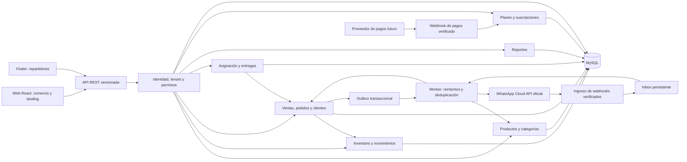

# Arquitectura propuesta

Diseño del ecosistema elaborado en Fase 0. La implementación y decisiones efectivas de Fase 1 están en [el informe actual](09-phase1.md); los módulos de fases posteriores siguen siendo propuestas.

## Enfoque

Monorepo con web React y API Node.js/TypeScript, más una aplicación Flutter que consume la misma API REST. Backend como monolito modular por dominios: facilita transacciones entre pedidos e inventario y evita operar varios servicios antes de que exista demanda real. Un proceso worker del mismo backend atenderá trabajos asíncronos cuando se incorpore WhatsApp.

MySQL con InnoDB y Prisma es la preferencia del encargo. La combinación exacta de Node, Prisma, adaptador y MySQL debe fijarse y probarse al iniciar la Fase 1; no se asume que cualquier versión denominada latest preserve las mismas APIs o soporte. Ver [decisiones](07-decisions-risks.md).

## Módulos y dependencias



El diagrama describe el destino del producto; en Fase 1 solo se implementa el subconjunto autorizado. Identidad protege todas las rutas privadas. Los webhooks tienen autenticación de proveedor y resolución de tenant propia, nunca una sesión de navegador.

| Dominio | Responsabilidad y frontera |
| --- | --- |
| identity / tenants | Usuarios, membresías, invitaciones, sesiones, permisos y selección validada de comercio |
| catalog | Productos, variantes/SKU, categorías, precios e imágenes |
| inventory | Único dueño de saldos, reservas y movimientos; otros módulos llaman sus servicios |
| customers | Clientes, teléfonos y direcciones dentro del comercio |
| orders / sales | Totales, confirmación, descuentos, estados comerciales e historial; venta directa usa el mismo núcleo |
| reporting | Consultas agregadas filtradas por tenant, fecha y permisos; no altera saldos |
| whatsapp | Adaptador Meta, conversaciones, mensajes, inbox/outbox; usa servicios de catálogo y pedidos |
| delivery | Repartidores, asignaciones, transiciones e incidencias; no duplica clientes ni inventario |
| billing | Planes versionados, límites, suscripciones y pagos del SaaS |
| platform-admin | Administración separada de NEXORA, permisos explícitos y auditoría; no es el administrador del comercio |
| audit / media / jobs | Capacidades transversales con contexto de tenant y mínimo acceso |

## Estructura futura

Este árbol es una propuesta; no representa carpetas implementadas.

```text
nexora/
  apps/
    web/src/
      app/                 # Router, providers y shell
      features/            # Páginas, hooks y servicios por dominio
      lib/                 # Cliente HTTP y utilidades de presentación
    api/
      src/
        app/               # Configuración, HTTP y composición
        modules/<domain>/  # routes, schemas, controllers, services, repositories
        infrastructure/    # Persistencia, correo, objetos, Meta y pagos
        workers/           # Jobs del mismo backend, desde Fase 3
      prisma/              # Esquema y migraciones de la versión elegida
      tests/               # Integración real con MySQL y fixtures aislados
    mobile/lib/
      app/
      core/                # HTTP, sesión y almacenamiento seguro
      features/            # Login, asignaciones, entrega e incidencias
  packages/
    shared/                # Contratos DTO/esquemas; nunca secretos o cliente DB
    design-system/         # Tokens y componentes React; fuente de tokens para Dart
  brand/
  docs/
  infrastructure/          # Desarrollo y despliegue reproducible
  scripts/
  AGENTS.md                # Pendiente de adoptar la propuesta
  PROJECT_STATUS.md
  README.md
  .env.example             # Se crea con las variables reales del scaffold
```

## Tecnologías y utilidad

| Capa | Propuesta | Justificación |
| --- | --- | --- |
| Web | React, TypeScript, Vite | Componentes tipados y desarrollo local |
| Navegación y datos | React Router, TanStack Query | Rutas y caché de estado remoto; limpiar al cerrar sesión/cambiar tenant |
| UI | Tailwind CSS, Lucide React, Recharts | Tokens, iconos consistentes y reportes al existir datos reales |
| Estado local | React inicialmente | Agregar Zustand solo si un flujo compartido lo justifica |
| API | Node.js, TypeScript, Express, Zod | HTTP modular, contratos y validación del servidor |
| Persistencia | MySQL/InnoDB + Prisma compatible | Relaciones, migraciones, restricciones y transacciones |
| Móvil | Flutter/Dart por funcionalidades | Un cliente de la API con interfaz de trabajo de campo |
| Paquetes JS | npm workspaces, un package-lock | npm ya está instalado; Flutter mantiene pubspec.lock separado |
| Pruebas propuestas | Vitest, Supertest, Playwright; flutter test/integration_test | Lógica, HTTP, flujos de navegador y móvil; validar versiones al crear proyectos |

No se agregaron dependencias en Fase 0. No se fija un proveedor cloud ni un broker de mensajes. Inbox/outbox persistentes en MySQL bastan como propuesta inicial; una cola administrada requiere justificar carga y operación.

## Contrato HTTP propuesto

- Prefijo `/api/v1`; documentar OpenAPI junto con la implementación.
- Contexto autenticado de servidor: usuario, sesión, membresía activa, tenant, permisos y requestId. Los DTO de negocio no pueden elegir tenant.
- Validación Zod en frontera, reglas en servicios y consultas en repositorios que exigen contexto de tenant. Los controladores no acceden directamente al cliente DB.
- Paginación con límite máximo; filtros y ordenación permitidos explícitamente. Listados y exportaciones tienen la misma política de acceso.
- Fechas ISO 8601 UTC; reportes usan zona `America/Bogota` y rangos `[inicio, fin)` convertidos a UTC.
- Dinero en strings decimales, moneda COP; cantidades enteras para el alcance inicial. Serialización y redondeo definidos en el modelo de datos.
- Errores con `code`, `message`, `requestId` y errores de campos seguros; 401 sesión inválida, 403 permiso insuficiente, 404 recurso no accesible, 409 conflicto de estado/stock y 422 validación.
- `Idempotency-Key` en operaciones críticas. Guardar hash de petición y resultado; misma clave con distinto cuerpo produce conflicto. Alcance por tenant, operación y actor, con política de retención definida por operación.
- Mutaciones de estado incluyen versión esperada para detectar carreras. No confiar en totales, precios, rol, plan o disponibilidad calculados por el cliente.

## Procesamiento asíncrono y despliegue

Una transacción escribe el cambio de negocio y un evento outbox. El worker procesa con entrega al menos una vez, lease, reintentos limitados y deduplicación; no se promete entrega exactamente una vez a servicios externos. Un timeout ambiguo requiere conciliación, especialmente en pagos y mensajes, antes de repetir operaciones con efectos.

API y worker sin estado local persistente, MySQL administrado y almacenamiento de objetos privado permiten crecer sin rediseñar los dominios. Web y API preferiblemente bajo el mismo origen mediante proxy `/api`, para simplificar cookies y CORS. Separar entornos de desarrollo, staging y producción; no crear infraestructura durante Fase 0.
