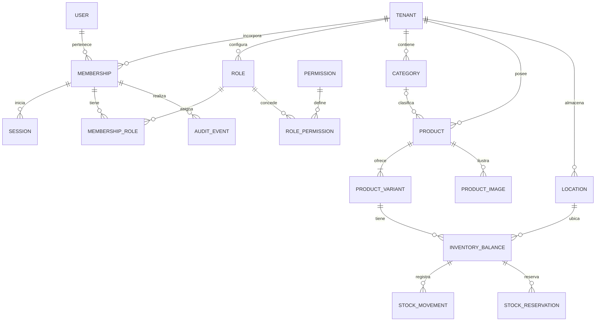
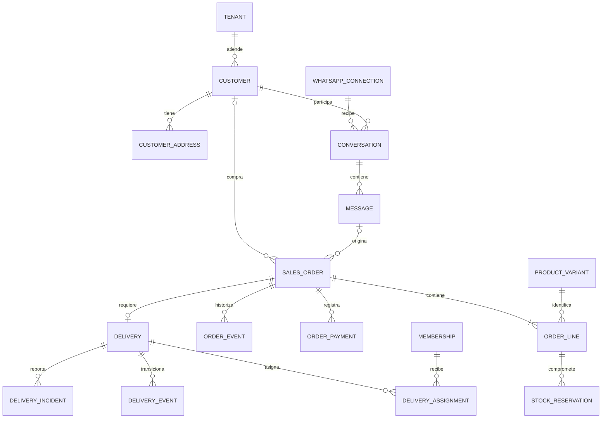
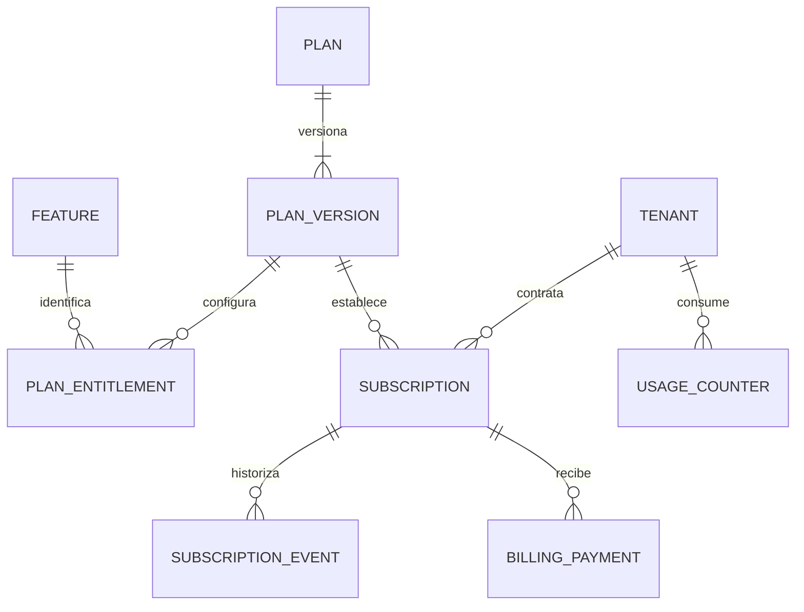

# Modelo de datos propuesto

Modelo lógico del ecosistema definido en Fase 0. El subconjunto implementado en Fase 1 está en [schema.prisma](../apps/api/prisma/schema.prisma) y sus migraciones. Las tablas futuras se implementan por fase. Las decisiones efectivas, incluidos roles predefinidos y un almacén, están en [el informe de Fase 1](09-phase1.md).

## Convenciones e invariantes

- IDs opacos generados en servidor. Cada tabla de negocio lleva `tenant_id NOT NULL`, `id`, `created_at` y, cuando corresponde, `updated_at` y `version`.
- Tablas globales: User, Tenant, Permission, Plan, PlanVersion y Feature. Sus lecturas/escrituras tienen políticas propias; no son un acceso general a datos de comercios.
- Tablas dependientes exponen `UNIQUE(tenant_id, id)` y referencias compuestas `(tenant_id, parent_id) -> Parent(tenant_id, id)`. La identidad global única de un ID no sustituye esa protección.
- Membership referencia al usuario global y al tenant; `UNIQUE(tenant_id, user_id)`. Rol y recursos del comercio se vinculan mediante claves compuestas. La sesión referencia una membresía existente, no un tenant sin validar.
- InnoDB, claves referenciadas explícitamente únicas e índices compatibles. Revisar el DDL real generado por Prisma y añadir SQL versionado cuando sea necesario. Las claves compuestas impiden relaciones cruzadas; no filtran lecturas por sí solas. [Referencia MySQL](https://dev.mysql.com/doc/refman/8.4/en/create-table-foreign-keys.html).
- Dinero `DECIMAL(18,2)`, moneda `COP`; API como string decimal (`"59900.00"`), nunca float binario para cálculos. Cantidades `INT` positivas en líneas; ajustes usan deltas con signo.
- Descuento por línea entre cero y su base; reparto proporcional del descuento global con residuo determinista por ID de línea. Redondeo decimal half-up a dos decimales por importe de línea. Total = suma de líneas netas + impuestos explícitos + domicilio, siempre no negativo. Régimen tributario y redondeo de cobro en pesos requieren decisión comercial; no se afirma facturación fiscal.
- Guardar snapshots de descripción, SKU, precio, descuentos, impuestos y dirección en pedidos confirmados; editar catálogo o cliente no reescribe historia.
- Fechas UTC con precisión de milisegundos; configuración del negocio conserva zona horaria. Precios y configuración tienen versión cuando afectan operaciones históricas.
- Archivar productos y desactivar usuarios/membresías; no borrar en cascada ventas, movimientos o auditoría. Para solicitudes sobre datos personales se definirá anonimización/retención compatible con registros necesarios.

## Identidad, catálogo e inventario

| Entidad | Campos y restricciones relevantes | Fase |
| --- | --- | --- |
| Tenant | name, slug único, timezone, currency, status | 1 |
| BusinessSettings | tenant_id único, datos de comercio y configuración permitida | 1 |
| User | email normalizado único, password_hash, status; no incluye rol global de comercio | 1 |
| Membership | tenant_id, user_id, status; desactivación revoca acceso | 1 |
| Invitation | tenant_id, email, token_hash único, expires_at, accepted_at; invitación de un solo uso | 1 |
| Role / Permission | Role por tenant con code único; Permission global con code único | 1 |
| MembershipRole / RolePermission | Unicidad de cada par, referencias dentro del mismo tenant para roles | 1 |
| Session / RefreshToken | membership_id, token_hash, expires_at, revoked_at; familia y rotación móvil desde Fase 4 | 1/4 |
| PasswordReset | user_id, token_hash único, expires_at, used_at | 1 |
| Category | tenant_id + nombre/slug normalizado único | 1 |
| Product | category_id opcional, name, description, status | 1 |
| ProductVariant | product_id, SKU único por tenant, atributos, price, cost restringido, status | 1 |
| ProductImage | product_id, object_key, mime, size, sort_order; no ruta arbitraria del cliente | 1 |
| Location | tenant_id, name; un almacén inicial por comercio | 1 |
| InventoryBalance | variant_id, location_id, on_hand, reserved, version; único por tenant/variante/ubicación | 1 |
| StockMovement | balance_id, delta_on_hand, delta_reserved, reason, actor_membership_id, operation_key, order_id opcional desde Fase 2 | 1/2 |
| StockReservation | balance_id, order_line_id, quantity, status, expires_at opcional, version | 2 |
| AuditEvent | actor, acción, recurso, request_id, resultado y metadatos redactados | 1 |

Producto sin opciones tiene una variante predeterminada: todo stock corresponde a un SKU. Cantidades fraccionarias, seriales de joyería y múltiples almacenes en interfaz quedan pendientes de validación; el alcance inicial usa unidades enteras y una ubicación.

## Ventas, WhatsApp y entregas

| Entidad | Campos y restricciones relevantes |
| --- | --- |
| Customer / CustomerAddress | Datos mínimos, phone_e164 opcional único por tenant cuando esté presente; direcciones privadas |
| SalesOrder | number único por tenant, customer_id opcional en mostrador, channel, status, payment_status, totals, currency, address_snapshot, version |
| OrderLine | order_id, variant_id, quantity, snapshots monetarios y de producto; no alterar tras confirmación |
| OrderEvent | estado previo/nuevo, actor, fecha, motivo; append-only |
| OrderPayment | Cobro del comercio: método, importe, moneda, estado y evidencia/referencia; separado de facturación del SaaS |
| Delivery | order_id único por tenant, estado, importe por cobrar derivado de pagos, version |
| DeliveryAssignment | delivery_id, courier_membership_id, assigned_at, accepted_at, ended_at; historial y un único asignado activo controlado transaccionalmente |
| DeliveryEvent / DeliveryIncident | actor, transición/motivo, fecha, evidencia privada y ubicación solo con consentimiento |
| WhatsAppConnection | tenant_id, phone_number_id global único, WABA ID, token cifrado o secret_ref, status |
| Conversation / Message | connection_id, customer_id; provider_message_id único por conexión, dirección, tipo, estado; contenido con retención definida |
| WebhookInbox | provider, external_connection_id, dedup_key única, tenant resuelto, payload protegido, processing_state, attempts |
| OutboxEvent | tenant_id, event_type, resource_id, payload mínimo, state, attempts, next_attempt_at, lease_until |
| IdempotencyRecord | tenant_id, actor, operation, key, request_hash, response_ref, expires_at; combinación única |

No se usa el teléfono como clave global de cliente: una persona puede comprar en dos comercios sin compartir historial. La deduplicación distingue mensajes entrantes de eventos de estado; varios estados pueden usar el mismo provider_message_id.

## Planes y facturación del SaaS

PlanVersion conserva precio, moneda, periodicidad, vigencia y duración de prueba configurable. PlanEntitlement define flags y límites tipados; un valor explícito representa ilimitado, cero representa ninguno. Subscription conserva plan/version, estado, fechas de prueba y vencimiento; los cambios generan historial. Una sola suscripción vigente por tenant se protege con bloqueo de una fila estable del tenant, no con un índice único mal definido sobre estados históricos.

BillingPayment conserva provider, provider_payment_id único, importe esperado, moneda, estado y eventos verificados. No es OrderPayment. UsageCounter se identifica por tenant, feature y periodo; la comprobación de límites y su incremento ocurren en una transacción para evitar excedentes por concurrencia.

Precios de referencia del encargo: Básico 59.900 COP/mes, Profesional 99.900 COP/mes, Empresarial 179.900 COP/mes. No están publicados ni cargados en un sistema de cobro. Límites, impuestos, prueba, prorrateo, gracia y degradación de plan siguen pendientes.

## Stock y transacciones

Invariantes por saldo: `on_hand >= 0`, `reserved >= 0`, `reserved <= on_hand`; disponible = on_hand - reserved. Las reservas activas deben sumar reserved. Cada variación tiene movimiento inmutable y actor o identidad de sistema. No se permiten ventas sin existencias en el alcance inicial.

1. Borrador: no reserva stock. Confirmación de pedido: consolidar SKU repetidos, validar cantidades, tomar bloqueos de saldos en orden estable, comprobar disponibilidad y aumentar reserved. Pedido, líneas, reservas, movimientos, auditoría y outbox se confirman juntos.
2. Venta inmediata: descontar on_hand únicamente si hay disponible suficiente; no consumir reservas de otros pedidos. Crear venta y movimiento en la misma transacción.
3. Recogida por repartidor o entrega directa al cliente: consumir la reserva disminuyendo on_hand y reserved una sola vez. Para domicilio sucede al pasar a recogido, no nuevamente al marcar entregado.
4. Cancelación antes de salida: liberar reserved. Después de salida: registrar incidencia/devolución; reponer on_hand solo al recibir físicamente mercancía y autorizar el movimiento.
5. Ajuste: delta con motivo y permiso, sin bajar on_hand por debajo de reserved. Correcciones mediante nuevos movimientos, no editando el historial.

Estrategia propuesta: transacción corta con bloqueo de filas o actualización condicional atómica con predicado de disponibilidad, versión y tenant. Fijar el mecanismo concreto con la versión Prisma elegida; si requiere SQL, usar parámetros y encapsularlo en el repositorio de inventario. Bloquear también el pedido/reserva antes de transición. Deadlocks y conflictos requieren rollback completo y reintento acotado con jitter, respetando idempotencia. Nunca llamar a Meta, correo o pasarela dentro de la transacción DB.

Prueba obligatoria: dos solicitudes simultáneas por la última unidad producen un solo éxito y un conflicto; el saldo no termina negativo y existe un solo consumo. Probar también cancelación contra recogida y repetición de la misma clave tras un timeout.

## Estados e índices

Pedido: `draft -> confirmed -> completed`; draft/confirmed pueden pasar a cancelled bajo las reglas de stock. El pago mantiene su propio estado. Para domicilio, completed se alcanza con entrega confirmada; el stock ya salió al recogerse.

Entrega: `pending -> assigned -> picked_up -> in_transit -> delivered`. Aceptar asignación registra accepted_at sin inventar otro estado. Antes de recogida puede cancelarse con motivo; después se tramita incidencia y cancelación autorizada, sin reposición automática. Reasignar antes de recogida cierra asignación previa y crea la nueva, con auditoría. Transiciones excepcionales posteriores requieren regla explícita; no hay PATCH libre de estado.

Índices iniciales: productos `(tenant_id, status, name)`; pedidos `(tenant_id, created_at, id)` y `(tenant_id, status, created_at)`; movimientos `(tenant_id, balance_id, created_at, id)`; asignaciones `(tenant_id, courier_membership_id, ended_at)`; mensajes `(tenant_id, conversation_id, created_at, id)`; trabajos `(state, next_attempt_at)`. Confirmar índices con consultas y EXPLAIN; no añadirlos indiscriminadamente.
